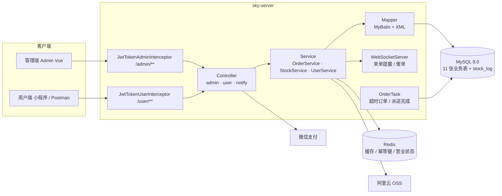

# 苍穹外卖 Sky Take-Out

面向餐饮商家的外卖点餐系统，包含 **管理端**（员工、分类、菜品、套餐、订单、报表）与 **用户端**（浏览、购物车、地址、下单、支付回调、催单）两条业务链路。

在课程版基础上做了工程化改造：用户端认证闭环、下单幂等、菜品/套餐双库存与库存流水回补、库存不足回滚、订单状态机（进行中）。

---

## 技术栈

| 分类 | 选型 |
|---|---|
| 框架 | Spring Boot 2.7.3、Spring MVC、MyBatis 2.2、PageHelper |
| 存储 | MySQL 8.0、Redis（缓存 + 幂等键） |
| 认证 | JWT（jjwt 0.9.1），管理端/用户端密钥隔离 |
| 通信 | WebSocket（来单提醒、催单） |
| 文档 | Knife4j / Swagger2 |
| 其他 | Druid、Lombok、fastjson、Apache POI、阿里云 OSS、微信支付 SDK |

## 架构



## 模块

```
sky-take-out
├── sky-common     常量、异常、工具类、JWT、OSS、微信支付
├── sky-pojo       entity / dto / vo
└── sky-server     启动类、controller、service、mapper、task、websocket、config
```

## 快速开始

### 1. 本地运行

前置：JDK 8+（本机验证用 JDK 21）、Maven 3.8+、MySQL 8.0、Redis 6+。

```bash
# 1）初始化数据库
mysql -uroot -p123456 -e "create database sky_take_out default charset utf8mb4"
mysql -uroot -p123456 sky_take_out < docs/sql/backup/baseline.sql
mysql -uroot -p123456 sky_take_out < docs/sql/V1_user_auth.sql
mysql -uroot -p123456 sky_take_out < docs/sql/V2_stock.sql

# 2）启动 Redis（示例）
redis-server

# 3）启动应用
mvn -DskipTests package
java -jar sky-server/target/sky-server-1.0-SNAPSHOT.jar
```

默认端口 `8080`，数据库/Redis 连接见 `sky-server/src/main/resources/application-dev.yml`。

### 2. Docker Compose

```bash
cp .env.example .env
docker compose up -d          # mysql + redis + app
docker compose logs -f app
```

首次启动会自动执行 `docs/sql/` 下的建表与增量脚本。

## 接口文档

启动后访问 <http://localhost:8080/doc.html>。

- 管理端：`/admin/**`，登录 `POST /admin/employee/login`（默认 admin / 123456），令牌放请求头 `token`
- 用户端：`/user/**`，登录 `POST /user/user/login`（body `{"code":"..."}`），令牌放请求头 `authentication`

> 本地未配置微信 appid 时，`sky.wechat.mock=true` 会用 code 派生稳定的 mock openid，无需真实微信账号即可联调。

## 关键设计

### 1. 用户端认证闭环

- 登录：`code` → openid → 查/建用户 → 签发 JWT；`user.openid` 唯一索引防并发重复注册
- 拦截器：`/user/**` 校验 `authentication`，`afterCompletion` 清理 `ThreadLocal`，避免线程复用串号
- 双端隔离：管理端与用户端使用不同密钥，admin token 调 `/user/**` 返回 401

### 2. 幂等下单

```
请求 → 幂等键（请求头 Idempotency-Key / 用户+地址+购物车指纹 md5）
     → Redis SETNX（5 分钟）
         ├─ 抢到：继续下单，事务内写订单
         └─ 未抢到：查订单表，命中则原样返回，未命中返回"处理中"
     → 订单表 (user_id, idempotency_key) 唯一索引兜底并发
     → 事务回滚时释放 Redis 键，允许用户修正后重试
```

### 3. 双库存与库存流水

- 扣减对象：散点菜品 + 套餐自身限量 + 套餐展开的组成菜品（`copies × 份数`）
- 同一 `dish_id` 先合并数量，再**按 id 升序**执行 `UPDATE ... WHERE stock >= ?`，固定加锁顺序避免死锁
- 任一条影响 0 行 → 抛 `StockNotEnoughException` → 整单回滚
- 扣减成功后写 `stock_log`（负向）；取消/拒单/超时按流水原路回补（正向）
- `stock_log` 唯一键 `(order_id, target_type, target_id, biz_type)` 保证回补幂等

### 4. 超时订单

当前为分钟级定时任务兜底（`OrderTask`），已接入库存回补。后续将改造为 Redis ZSet 延迟队列 + 秒级轮询，见 Roadmap。

### 5. 缓存

当前 C 端菜品/套餐使用 Spring Cache + Redis（30 分钟 TTL，管理端写操作按 key 失效）。后续将改造为手写 `CacheClient`，补齐穿透/击穿/雪崩处理，并把库存从缓存中剥离。

## 数据库

11 张业务表 + 1 张库存流水：

`employee` `category` `dish` `dish_flavor` `setmeal` `setmeal_dish` `orders` `order_detail` `shopping_cart` `address_book` `user` `stock_log`

增量脚本：

| 脚本 | 内容 |
|---|---|
| `docs/sql/V1_user_auth.sql` | `user.openid` 唯一索引 |
| `docs/sql/V2_stock.sql` | `dish.stock`、`setmeal.stock`、`orders.idempotency_key`、`uk_user_idem`、`idx_status_order_time`、`stock_log` |

## 验证

验证脚本在 `docs/verify/`，逐项断言并输出 PASS/FAIL：

```bash
powershell -NoProfile -ExecutionPolicy Bypass -File docs/verify/t02-verify.ps1
```

记录见 [docs/verification.md](docs/verification.md)。

## Roadmap

- [x] T01 用户端微信登录 + JWT 拦截器（双端隔离）
- [x] T02 双库存 + 幂等下单 + 库存流水
- [ ] T04 超时订单改造为 Redis ZSet 延迟队列
- [ ] T05 WebSocket 并发安全与多实例方案
- [ ] T06 手写 CacheClient（穿透/击穿/雪崩 + 库存与缓存解耦）
- [ ] T07 报表 SXSSF 流式导出 + 统计索引
- [ ] T08 单元测试与接口测试
- [ ] T09 订单状态机 + 并发条件更新
- [ ] T10-T12 AI 能力（自然语言点餐、商家经营洞察）

## 已知问题

- 微信支付/退款依赖真实商户号，本地为模拟链路
- 报表前端尚未接入
