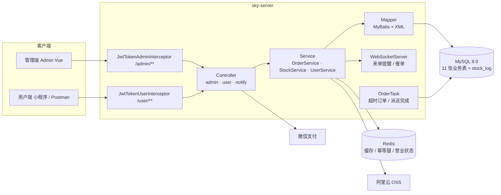

# 苍穹外卖 Sky Take-Out

面向餐饮商家的外卖点餐系统，包含 **管理端**（员工、分类、菜品、套餐、订单、报表）与 **用户端**（浏览、购物车、地址、下单、支付回调、催单）两条业务链路。

在课程版基础上做了工程化改造：用户端认证闭环、下单幂等、菜品/套餐双库存与库存流水回补、超时订单延迟队列、手写缓存层、订单状态机与并发条件更新，并配套可复跑的验证脚本（`docs/verify/`）与验证记录（`docs/verification.md`）。

---

## 技术栈

| 分类 | 选型 |
|---|---|
| 框架 | Spring Boot 2.7.3、Spring MVC、MyBatis 2.2、PageHelper |
| 存储 | MySQL 8.0、Redis（缓存 + 幂等键） |
| 认证 | JWT（jjwt 0.9.1），管理端/用户端密钥隔离 |
| 通信 | WebSocket（来单提醒、催单） |
| 文档 | Knife4j / Swagger2 |
| 其他 | Druid、Lombok、fastjson、Apache POI、阿里云 OSS、微信支付 SDK |

## 架构



## 模块

```
sky-take-out
├── sky-common     常量、异常、工具类、JWT、OSS、微信支付
├── sky-pojo       entity / dto / vo
└── sky-server     启动类、controller、service、mapper、task、websocket、config
```

## 快速开始

### 1. 本地运行

前置：JDK 8+（本机验证用 JDK 21）、Maven 3.8+、MySQL 8.0、Redis 6+。

```bash
# 1）初始化数据库
mysql -uroot -p123456 -e "create database sky_take_out default charset utf8mb4"
mysql -uroot -p123456 sky_take_out < docs/sql/backup/baseline.sql
mysql -uroot -p123456 sky_take_out < docs/sql/V1_user_auth.sql
mysql -uroot -p123456 sky_take_out < docs/sql/V2_stock.sql

# 2）启动 Redis（示例）
redis-server

# 3）启动应用
mvn -DskipTests package
java -jar sky-server/target/sky-server-1.0-SNAPSHOT.jar
```

默认端口 `8080`，数据库/Redis 连接见 `sky-server/src/main/resources/application-dev.yml`。

### 2. Docker Compose

```bash
cp .env.example .env
docker compose up -d          # mysql + redis + app
docker compose logs -f app
```

首次启动会自动执行 `docs/sql/` 下的建表与增量脚本。

## 接口文档

启动后访问 <http://localhost:8080/doc.html>。

- 管理端：`/admin/**`，登录 `POST /admin/employee/login`（默认 admin / 123456），令牌放请求头 `token`
- 用户端：`/user/**`，登录 `POST /user/user/login`（body `{"code":"..."}`），令牌放请求头 `authentication`

> 本地未配置微信 appid 时，`sky.wechat.mock=true` 会用 code 派生稳定的 mock openid，无需真实微信账号即可联调。

## 关键设计

### 1. 用户端认证闭环

- 登录：`code` → openid → 查/建用户 → 签发 JWT；`user.openid` 唯一索引防并发重复注册
- 拦截器：`/user/**` 校验 `authentication`，`afterCompletion` 清理 `ThreadLocal`，避免线程复用串号
- 双端隔离：管理端与用户端使用不同密钥，admin token 调 `/user/**` 返回 401

### 2. 幂等下单

```
请求 → 幂等键（请求头 Idempotency-Key / 用户+地址+购物车指纹 md5）
     → Redis SETNX（5 分钟）
         ├─ 抢到：继续下单，事务内写订单
         └─ 未抢到：查订单表，命中则原样返回，未命中返回"处理中"
     → 订单表 (user_id, idempotency_key) 唯一索引兜底并发
     → 事务回滚时释放 Redis 键，允许用户修正后重试
```

### 3. 双库存与库存流水

- 扣减对象：散点菜品 + 套餐自身限量 + 套餐展开的组成菜品（`copies × 份数`）
- 同一 `dish_id` 先合并数量，再**按 id 升序**执行 `UPDATE ... WHERE stock >= ?`，固定加锁顺序避免死锁
- 任一条影响 0 行 → 抛 `StockNotEnoughException` → 整单回滚
- 扣减成功后写 `stock_log`（负向）；取消/拒单/超时按流水原路回补（正向）
- `stock_log` 唯一键 `(order_id, target_type, target_id, biz_type)` 保证回补幂等

### 4. 超时订单：Redis ZSet 延迟队列

- 下单事务**提交后**把 `orderId` 写入 ZSet `order:timeout`，score = 下单时间 + 15 分钟（回滚则不入队）
- `@Scheduled(fixedDelay = 1000)` 每秒取到期订单 → `ZREM` 抢占成功者才处理 → 条件更新 `where id=? and status=1` → 按流水回补库存
- `ZREM` 返回值天然实现多实例去重；`status=1` 条件保证已支付订单不会被超时任务误取消
- 对比原实现（每分钟全表扫描 + 逐条 update）：扫描量与订单总量无关

### 5. 缓存：手写 CacheClient

放弃注解式 `@Cacheable`（无法对单 key 做随机 TTL、无法互斥重建、默认不缓存 null），改为 `CacheClient`：

| 问题 | 手段 |
|---|---|
| 穿透 | 空值哨兵（查不到写 `__NULL__`，TTL 2 分钟） |
| 击穿 | `SETNX` 互斥重建，未抢到锁的线程短暂等待后兜底直查 |
| 雪崩 | TTL 30 分钟 ± 5 分钟随机 |

**库存不进缓存**：列表只缓存静态信息（名称/价格/口味/组成），库存读取时按 id 批量补全、套餐可售量实时聚合。否则每成一单都要失效缓存，缓存等于没有。
管理端写操作通过自定义 `@ClearCache(pattern)` + AOP 按前缀清理（SCAN，非 KEYS）。

### 6. 订单状态机

- `OrderStatusTransfer` 定义合法流转：`1→2/6`、`2→3/6`、`3→4/6`、`4→5/6`，终态不可再流转
- 所有状态变更走 `update orders ... where id=? and status=fromStatus`，影响 0 行抛 `ORDER_STATUS_ERROR`
- 并发场景（商家接单 vs 用户取消）只有一方能成功，另有单元测试覆盖非法流转


## AI 点餐助手（T10 / T11）

面向门店的"扫码点餐"助手：用户用一句话描述需求，返回 3~5 道菜的推荐与理由。**AI 只推荐，不写购物车、不自动下单**，加购由用户点击触发。

### 接口

| 接口 | 说明 |
|---|---|
| `POST /user/ai/recommendSync` | 同步推荐（演示与脚本使用） |
| `POST /user/ai/recommend` | SSE 事件流（事件级，非 token 级） |
| `GET /user/ai/status` | 模型、熔断、今日调用次数与 token |
| `POST /admin/ai/tag/refresh` | 菜品打标（离线批处理，可重跑） |

### 架构：四道闸门

```
ai/client    LlmClient        OpenAI 兼容、共享连接池、超时 4s、无重试
ai/validate  IntentValidator  字段白名单/区间校验；越界丢弃，结构错才失败
ai/guard     AiRateLimiter    Redis 令牌桶（10 次/小时/用户）+ 结果缓存 10 分钟
ai/log       ai_call_log      token、耗时、降级标记，可查成本
```

**核心约束：模型只输出"条件"（辣度/人数/预算/忌口/品类），绝不输出菜品 ID。** 菜品一律由本地检索决定，这是防幻觉的第一道闸门。

### 降级策略（任何一步失败都不允许报错）

| 场景 | 行为 |
|---|---|
| 空输入 / 只有"随便" | `mode=DEFAULT`，不调模型，返回热销 Top5（15ms、0 成本）|
| 模型超时 / 不可用 | `mode=DEGRADED`，返回热销 + `needConfirm=true` |
| 熔断开关打开 | 直接降级，不发起模型调用 |
| 触发限流 | 降级并提示"今天问得有点多了" |
| 只解析出 keyword 且无菜品命中 | 判定"没听懂"，走 DEFAULT 而不是硬推荐 |

### 评测

自建 200 条评测集（170 标准 + 30 脏输入，含错别字/语音碎片），脚本 `docs/verify/t11-eval.ps1`：

| 指标 | 结果 |
|---|---|
| 整体准确率（4 字段全对） | **95.5%** |
| 标准集 | **100%** |
| 脏输入集 | 70%（人工复核后多为标注口径歧义，非模型错误）|
| 字段级 | spicy 96% / people 100% / budget 100% / exclude 99.5% |

模型在脏输入上还体现出了纠错能力：`香采→香菜`、`宫爆→宫保`、`两各人→2人`、`六十→60`。

### 性能与成本

- 进程启动后首次调用 ~5s（TLS 握手 + 类加载），之后稳定 **0.8s**，缓存命中 **23ms**
- 单次约 500 token，按 DeepSeek 价格单次 1 分钱以内
- 关闭了"生成推荐理由"的第二次调用（`sky.ai.reason-enabled=false`），延迟直接减半

### 演示入口

启动后在浏览器打开（手机模式效果更好）：

```
http://127.0.0.1:8080/ai/index.html
```

页面是模拟"扫桌码"的 H5：桌宠气泡 + 语音输入（Chrome/Edge 的 Web Speech API）+ 推荐卡片 + 手动加购 + TTS 播报。
## 商家经营洞察（T12）

从"评价"到"可行动建议"的闭环：用户下单后评价 → 离线规则分析 → 商家看板。

### 接口

| 接口 | 说明 |
|---|---|
| `POST /user/comment` | C 端提交评价（订单完成后、一单一评、1-5 星） |
| `POST /admin/comment/analyze` | 批量分析未处理评价（幂等、可重跑） |
| `GET /admin/comment/insight` | 差评主题 Top5 + 均分 + 差评率 + 按天趋势 + AI 周报 |
| `POST /admin/comment/insight/refresh` | 主动失效洞察缓存（导入/重算后必须调用） |
| `GET /admin/comment/page` | 评价分页 |

### 成本设计：把最贵的工具只用在刀刃上

| 环节 | 手段 | 成本 |
|---|---|---|
| 主题抽取 | 6 类词表（配送/分量/口味/包装/服务/价格） | **0** |
| 情感判定 | 评分优先（1-2 差评、4-5 好评）+ 情感词兜底 | **0** |
| 周报建议 | **唯一一次模型调用**，按时间范围缓存 10 分钟 | 约 1 分钱 |

实测：610 条评价规则分析 **0 token / 3.3s**，周报 **1 次调用 / 207 token**。

### 看板

```
http://127.0.0.1:8080/ai/merchant.html
```

流动极光背景 + 动态柱状榜 + 趋势曲线描边动画 + AI 周报打字机；每 60 秒自动刷新，可手动「重算缓存」。

### 缓存一致性

洞察结果按时间范围缓存 10 分钟。数据导入或重算后必须调用 `/admin/comment/insight/refresh`，
否则会读到旧结果——这是实际踩过的坑，验证记录见 `docs/verification.md`。
## 数据库

11 张业务表 + 1 张库存流水：

`employee` `category` `dish` `dish_flavor` `setmeal` `setmeal_dish` `orders` `order_detail` `shopping_cart` `address_book` `user` `stock_log`

增量脚本：

| 脚本 | 内容 |
|---|---|
| `docs/sql/V1_user_auth.sql` | `user.openid` 唯一索引 |
| `docs/sql/V2_stock.sql` | `dish.stock`、`setmeal.stock`、`orders.idempotency_key`、`uk_user_idem`、`idx_status_order_time`、`stock_log` |
| `docs/sql/V3_report_index.sql` | `order_detail(order_id)`、`user(create_time)` 索引 |

## 验证

验证脚本在 `docs/verify/`，逐项断言并输出 PASS/FAIL；完整记录见 [docs/verification.md](docs/verification.md)。

```bash
# 端到端冒烟：登录 → 地址 → 加购 → 下单 → 取消 → 库存回补
powershell -NoProfile -ExecutionPolicy Bypass -File docs/verify/phase0-smoke.ps1
# 各任务卡验证
powershell -NoProfile -ExecutionPolicy Bypass -File docs/verify/t02-verify.ps1   # 幂等 + 双库存
powershell -NoProfile -ExecutionPolicy Bypass -File docs/verify/t04-verify.ps1   # 超时延迟队列
powershell -NoProfile -ExecutionPolicy Bypass -File docs/verify/t05-verify.ps1   # WebSocket
powershell -NoProfile -ExecutionPolicy Bypass -File docs/verify/t06-verify.ps1   # 缓存
powershell -NoProfile -ExecutionPolicy Bypass -File docs/verify/t07-verify.ps1   # 报表
powershell -NoProfile -ExecutionPolicy Bypass -File docs/verify/t09-verify.ps1   # 状态机并发
# 单元测试 / 集成测试
mvn test -Dtest=OrderStatusTransferTest,CacheClientTest
```

关键结果：

| 场景 | 结果 |
|---|---|
| 20 并发同一幂等键 | 只落 1 单，库存只扣一次 |
| 两用户并发抢库存 5（各买 3） | 一成一败，末态 2，无负库存 |
| 套餐含售罄组成菜品 | 整单拒绝，套餐库存不变 |
| 50 并发冷 key（缓存） | 63 条 SQL，无缓存基线约 450 条 |
| 下单 5 次后缓存状态 | key 仍存在，库存实时反映 |
| 30 天三类报表统计 | 8 条 SQL（原实现约 90 条） |
| 10 轮「接单 vs 取消」并发 | 每轮仅一方成功，末态全部合法 |

## Roadmap

- [x] T01 用户端微信登录 + JWT 拦截器（双端隔离）
- [x] T02 双库存 + 幂等下单 + 库存流水回补
- [x] T03 README / Dockerfile / compose 编排
- [x] T04 超时订单改造为 Redis ZSet 延迟队列
- [x] T05 WebSocket 并发安全、心跳与多实例方案说明
- [x] T06 手写 CacheClient（穿透/击穿/雪崩 + 库存与缓存解耦）
- [x] T07 报表按天聚合查询优化 + 统计索引 + 导出接口
- [x] T08 单元测试与集成测试（状态机 / 缓存）
- [x] T09 订单状态机 + 并发条件更新
- [x] T10 AI 网关（模型客户端 / 校验 / 限流 / 日志 / 熔断 / mock）
- [x] T11 自然语言点餐（菜品打标 + 意图解析 + 检索打分 + 降级 + 200 条评测）
- [x] T11.5 扫码点餐 H5 演示页（桌宠气泡 / 语音 / 加购）
- [x] T12 评价与商家洞察（词表分析 + LLM 周报 + 缓存失效）
- [x] T12.5 商家经营看板 H5（流动背景 / 动态柱状 / 趋势曲线）
- [ ] T12.6 种子数据脚本固化（一键重建 600 单/600 评价，便于复现与回归）
- [ ] T13 销量预测（非 LLM，MAPE 评估）
- [ ] 语音智能体（讯飞 ASR/TTS 流式接入，放 Roadmap）

> T07 说明：报表模板行数固定 30 行，未引入 SXSSF 流式导出；真实瓶颈是「按天循环查库」，
> 已改为一次 `GROUP BY` 聚合。数据量决定技术选型，不为技术而技术。

## 已知问题

- 微信支付/退款依赖真实商户号，本地为模拟链路
- 报表前端尚未接入
- AI 推荐理由默认用模板（关闭了第二次模型调用以换取延迟），需要时可以开 `sky.ai.reason-enabled`
- 语音输入依赖浏览器 Web Speech API，仅 Chrome/Edge 支持；讯飞接入放在 Roadmap
- 启动应用时需显式传入 `DEEPSEEK_API_KEY`（`Start-Process` 启动的进程不继承用户环境变量）
