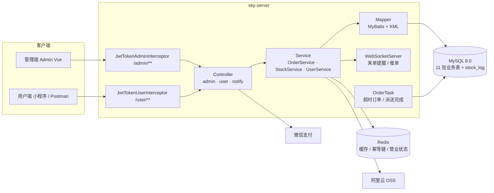

# 苍穹外卖 Sky Take-Out

面向餐饮商家的外卖点餐系统，包含 **管理端**（员工、分类、菜品、套餐、订单、报表）与 **用户端**（浏览、购物车、地址、下单、支付回调、催单）两条业务链路。

在课程版基础上做了工程化改造：用户端认证闭环、下单幂等、菜品/套餐双库存与库存流水回补、超时订单延迟队列、手写缓存层、订单状态机与并发条件更新，并配套可复跑的验证脚本（`docs/verify/`）与验证记录（`docs/verification.md`）。

---

## 技术栈

| 分类 | 选型 |
|---|---|
| 框架 | Spring Boot 2.7.3、Spring MVC、MyBatis 2.2、PageHelper |
| 存储 | MySQL 8.0、Redis（缓存 + 幂等键） |
| 认证 | JWT（jjwt 0.9.1），管理端/用户端密钥隔离 |
| 通信 | WebSocket（来单提醒、催单） |
| 文档 | Knife4j / Swagger2 |
| 其他 | Druid、Lombok、fastjson、Apache POI、阿里云 OSS、微信支付 SDK |

## 架构



## 模块

```
sky-take-out
├── sky-common     常量、异常、工具类、JWT、OSS、微信支付
├── sky-pojo       entity / dto / vo
└── sky-server     启动类、controller、service、mapper、task、websocket、config
```

## 快速开始

### 1. 本地运行

前置：JDK 8+（本机验证用 JDK 21）、Maven 3.8+、MySQL 8.0、Redis 6+。

```bash
# 1）初始化数据库
mysql -uroot -p123456 -e "create database sky_take_out default charset utf8mb4"
mysql -uroot -p123456 sky_take_out < docs/sql/backup/baseline.sql
mysql -uroot -p123456 sky_take_out < docs/sql/V1_user_auth.sql
mysql -uroot -p123456 sky_take_out < docs/sql/V2_stock.sql

# 2）启动 Redis（示例）
redis-server

# 3）启动应用
mvn -DskipTests package
java -jar sky-server/target/sky-server-1.0-SNAPSHOT.jar
```

默认端口 `8080`，数据库/Redis 连接见 `sky-server/src/main/resources/application-dev.yml`。

### 2. Docker Compose

```bash
cp .env.example .env
docker compose up -d          # mysql + redis + app
docker compose logs -f app
```

首次启动会自动执行 `docs/sql/` 下的建表与增量脚本。

## 接口文档

启动后访问 <http://localhost:8080/doc.html>。

- 管理端：`/admin/**`，登录 `POST /admin/employee/login`（默认 admin / 123456），令牌放请求头 `token`
- 用户端：`/user/**`，登录 `POST /user/user/login`（body `{"code":"..."}`），令牌放请求头 `authentication`

> 本地未配置微信 appid 时，`sky.wechat.mock=true` 会用 code 派生稳定的 mock openid，无需真实微信账号即可联调。

## 关键设计

### 1. 用户端认证闭环

- 登录：`code` → openid → 查/建用户 → 签发 JWT；`user.openid` 唯一索引防并发重复注册
- 拦截器：`/user/**` 校验 `authentication`，`afterCompletion` 清理 `ThreadLocal`，避免线程复用串号
- 双端隔离：管理端与用户端使用不同密钥，admin token 调 `/user/**` 返回 401

### 2. 幂等下单

```
请求 → 幂等键（请求头 Idempotency-Key / 用户+地址+购物车指纹 md5）
     → Redis SETNX（5 分钟）
         ├─ 抢到：继续下单，事务内写订单
         └─ 未抢到：查订单表，命中则原样返回，未命中返回"处理中"
     → 订单表 (user_id, idempotency_key) 唯一索引兜底并发
     → 事务回滚时释放 Redis 键，允许用户修正后重试
```

### 3. 双库存与库存流水

- 扣减对象：散点菜品 + 套餐自身限量 + 套餐展开的组成菜品（`copies × 份数`）
- 同一 `dish_id` 先合并数量，再**按 id 升序**执行 `UPDATE ... WHERE stock >= ?`，固定加锁顺序避免死锁
- 任一条影响 0 行 → 抛 `StockNotEnoughException` → 整单回滚
- 扣减成功后写 `stock_log`（负向）；取消/拒单/超时按流水原路回补（正向）
- `stock_log` 唯一键 `(order_id, target_type, target_id, biz_type)` 保证回补幂等

### 4. 超时订单：Redis ZSet 延迟队列

- 下单事务**提交后**把 `orderId` 写入 ZSet `order:timeout`，score = 下单时间 + 15 分钟（回滚则不入队）
- `@Scheduled(fixedDelay = 1000)` 每秒取到期订单 → `ZREM` 抢占成功者才处理 → 条件更新 `where id=? and status=1` → 按流水回补库存
- `ZREM` 返回值天然实现多实例去重；`status=1` 条件保证已支付订单不会被超时任务误取消
- 对比原实现（每分钟全表扫描 + 逐条 update）：扫描量与订单总量无关

### 5. 缓存：手写 CacheClient

放弃注解式 `@Cacheable`（无法对单 key 做随机 TTL、无法互斥重建、默认不缓存 null），改为 `CacheClient`：

| 问题 | 手段 |
|---|---|
| 穿透 | 空值哨兵（查不到写 `__NULL__`，TTL 2 分钟） |
| 击穿 | `SETNX` 互斥重建，未抢到锁的线程短暂等待后兜底直查 |
| 雪崩 | TTL 30 分钟 ± 5 分钟随机 |

**库存不进缓存**：列表只缓存静态信息（名称/价格/口味/组成），库存读取时按 id 批量补全、套餐可售量实时聚合。否则每成一单都要失效缓存，缓存等于没有。
管理端写操作通过自定义 `@ClearCache(pattern)` + AOP 按前缀清理（SCAN，非 KEYS）。

### 6. 订单状态机

- `OrderStatusTransfer` 定义合法流转：`1→2/6`、`2→3/6`、`3→4/6`、`4→5/6`，终态不可再流转
- 所有状态变更走 `update orders ... where id=? and status=fromStatus`，影响 0 行抛 `ORDER_STATUS_ERROR`
- 并发场景（商家接单 vs 用户取消）只有一方能成功，另有单元测试覆盖非法流转


## 数据库

11 张业务表 + 1 张库存流水：

`employee` `category` `dish` `dish_flavor` `setmeal` `setmeal_dish` `orders` `order_detail` `shopping_cart` `address_book` `user` `stock_log`

增量脚本：

| 脚本 | 内容 |
|---|---|
| `docs/sql/V1_user_auth.sql` | `user.openid` 唯一索引 |
| `docs/sql/V2_stock.sql` | `dish.stock`、`setmeal.stock`、`orders.idempotency_key`、`uk_user_idem`、`idx_status_order_time`、`stock_log` |
| `docs/sql/V3_report_index.sql` | `order_detail(order_id)`、`user(create_time)` 索引 |

## 验证

验证脚本在 `docs/verify/`，逐项断言并输出 PASS/FAIL；完整记录见 [docs/verification.md](docs/verification.md)。

```bash
# 端到端冒烟：登录 → 地址 → 加购 → 下单 → 取消 → 库存回补
powershell -NoProfile -ExecutionPolicy Bypass -File docs/verify/phase0-smoke.ps1
# 各任务卡验证
powershell -NoProfile -ExecutionPolicy Bypass -File docs/verify/t02-verify.ps1   # 幂等 + 双库存
powershell -NoProfile -ExecutionPolicy Bypass -File docs/verify/t04-verify.ps1   # 超时延迟队列
powershell -NoProfile -ExecutionPolicy Bypass -File docs/verify/t05-verify.ps1   # WebSocket
powershell -NoProfile -ExecutionPolicy Bypass -File docs/verify/t06-verify.ps1   # 缓存
powershell -NoProfile -ExecutionPolicy Bypass -File docs/verify/t07-verify.ps1   # 报表
powershell -NoProfile -ExecutionPolicy Bypass -File docs/verify/t09-verify.ps1   # 状态机并发
# 单元测试 / 集成测试
mvn test -Dtest=OrderStatusTransferTest,CacheClientTest
```

关键结果：

| 场景 | 结果 |
|---|---|
| 20 并发同一幂等键 | 只落 1 单，库存只扣一次 |
| 两用户并发抢库存 5（各买 3） | 一成一败，末态 2，无负库存 |
| 套餐含售罄组成菜品 | 整单拒绝，套餐库存不变 |
| 50 并发冷 key（缓存） | 63 条 SQL，无缓存基线约 450 条 |
| 下单 5 次后缓存状态 | key 仍存在，库存实时反映 |
| 30 天三类报表统计 | 8 条 SQL（原实现约 90 条） |
| 10 轮「接单 vs 取消」并发 | 每轮仅一方成功，末态全部合法 |

## Roadmap

- [x] T01 用户端微信登录 + JWT 拦截器（双端隔离）
- [x] T02 双库存 + 幂等下单 + 库存流水回补
- [x] T03 README / Dockerfile / compose 编排
- [x] T04 超时订单改造为 Redis ZSet 延迟队列
- [x] T05 WebSocket 并发安全、心跳与多实例方案说明
- [x] T06 手写 CacheClient（穿透/击穿/雪崩 + 库存与缓存解耦）
- [x] T07 报表按天聚合查询优化 + 统计索引 + 导出接口
- [x] T08 单元测试与集成测试（状态机 / 缓存）
- [x] T09 订单状态机 + 并发条件更新
- [ ] T10-T12 AI 能力（自然语言点餐、商家经营洞察）

> T07 说明：报表模板行数固定 30 行，未引入 SXSSF 流式导出；真实瓶颈是「按天循环查库」，
> 已改为一次 `GROUP BY` 聚合。数据量决定技术选型，不为技术而技术。

## 已知问题

- 微信支付/退款依赖真实商户号，本地为模拟链路
- 报表前端尚未接入
- Docker 镜像构建与 `compose up` 未在本机验证（Docker Desktop 守护进程未运行）；`docker compose config` 已通过
